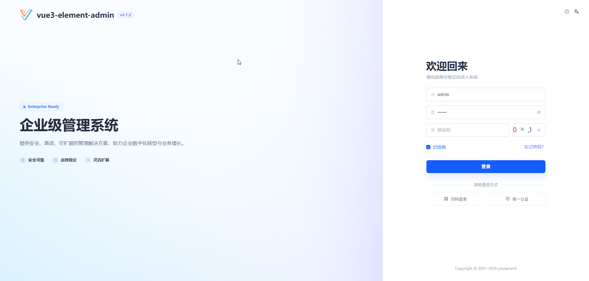
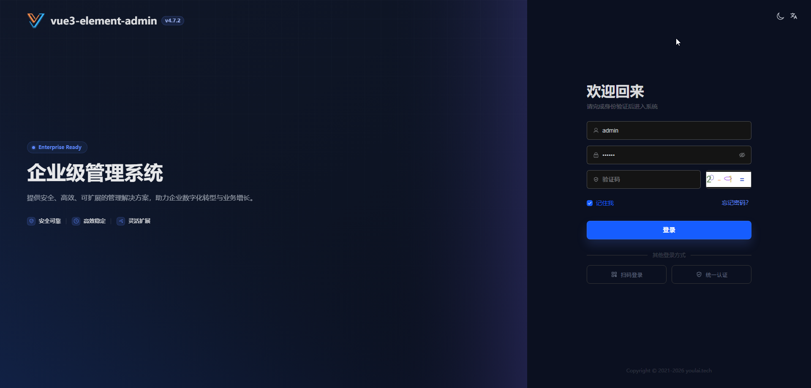
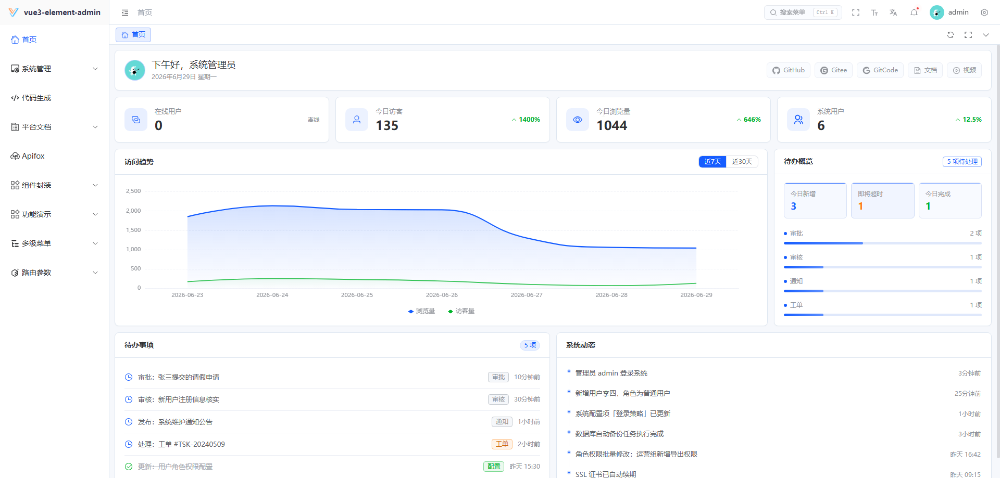
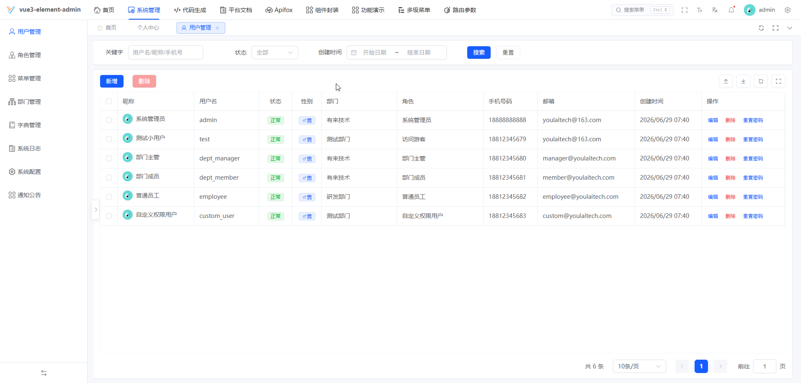
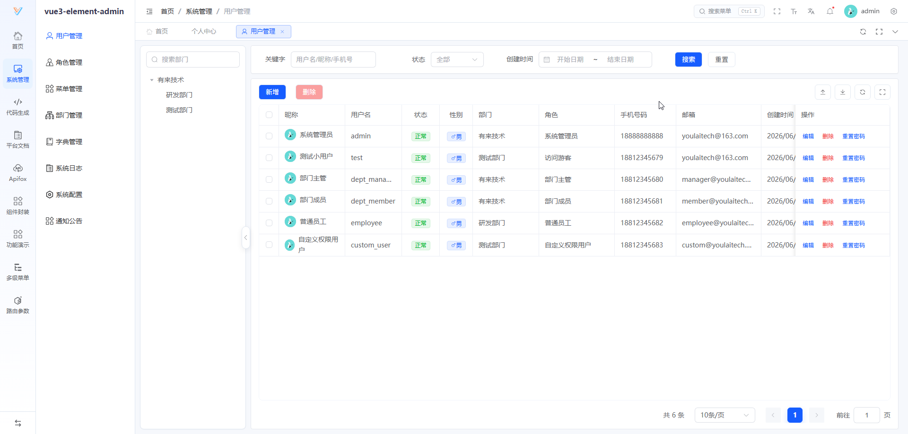
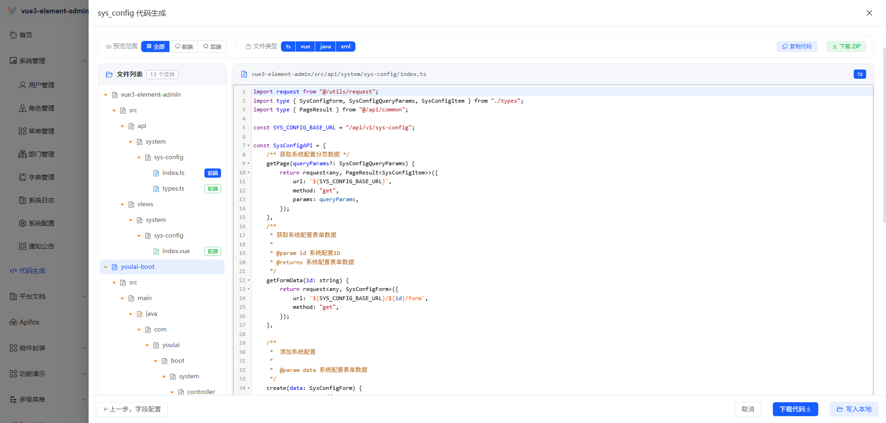
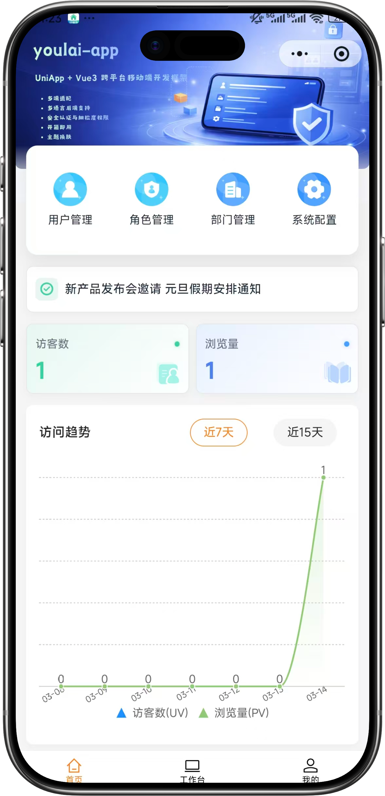
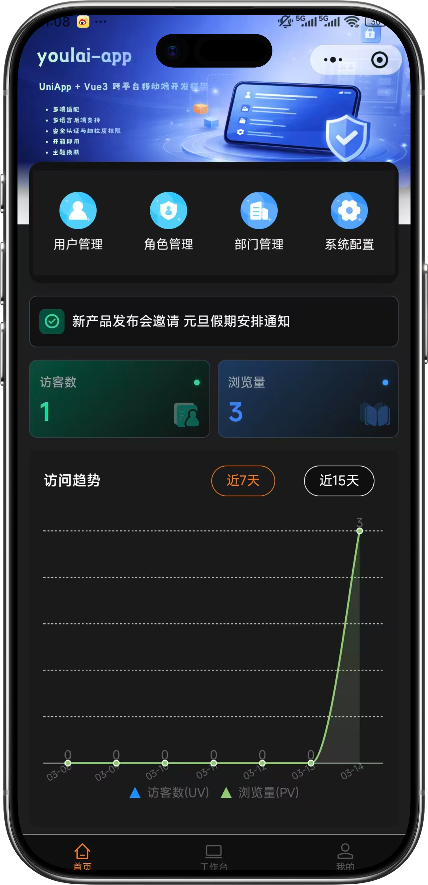
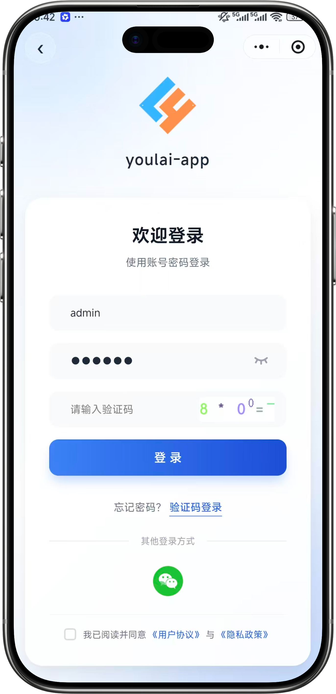
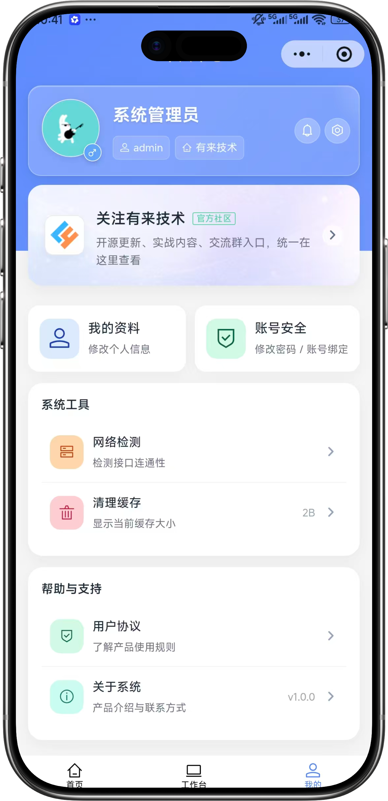

<div align="center">

#  youlai-rust

[English](./README.en.md) · [简体中文](./README.md)

**Enterprise-grade permission management backend based on Rust (Axum + SeaORM)**

[](https://www.rust-lang.org/)
[](https://github.com/tokio-rs/axum)
[](https://www.postgresql.org/)
[](https://redis.io/)
[](LICENSE)
[](https://gitee.com/youlaiorg/youlai-rust/stargazers)
[](https://github.com/youlaitech/youlai-rust)

</div>


<div align="center">

[🖥️ Live Preview](https://vue.youlai.tech) | [📱 Mobile Preview](https://app.youlai.tech) | [📖 Documentation](https://www.youlai.tech/docs/server/spring-boot/)

</div>

## Introduction

**youlai-rust** is an enterprise-grade permission management backend built on Rust (Axum + SeaORM + PostgreSQL), with the frontend [vue3-element-admin](https://gitee.com/youlaiorg/vue3-element-admin) and the mobile app [youlai-app](https://gitee.com/youlaiorg/youlai-app). It is one of the official **7 language implementations** (Java / Node.js / Go / Python / PHP / C# / Rust), sharing the same **RESTful API specification** and **database schema**, so the frontend can switch seamlessly. It is ideal for Rust teams that demand high concurrency and low latency.

## Core Features

- 🔐 **Dual-mode auth** — JWT self-contained / Redis Token stateful, switchable via config, with token renewal
- 🛡️ **Fine-grained permissions** — RBAC at data / menu / button / API level; data scope supports ALL / dept & sub-depts / current dept / self / custom dept
- ⚡ **Code generator** — one-click generation of full-stack CRUD code (codegen module)
- 📦 **Complete modules** — users, roles, menus, departments, dictionaries, configs, files, notices, operation logs
- 🌐 **Multi-language ecosystem** — shares the API specification and database schema with other language versions
- 🔌 **Real-time communication** — SSE push: online user count, dictionary sync, notification broadcast
- 📊 **Observability** — tracing structured logs + tower middleware recording request latency; utoipa auto-generates Swagger UI
- 📁 **Excel handling** — calamine for reading + rust_xlsxwriter for writing, with import/export support

## System Preview

**PC**

<table align="center">
  <tr>
    <td></td>
    <td></td>
  </tr>
  <tr>
    <td></td>
    <td></td>
  </tr>
  <tr>
    <td></td>
    <td></td>
  </tr>
</table>

**Mobile**

<table align="center">
  <tr>
    <td></td>
    <td></td>
    <td></td>
    <td></td>
  </tr>
</table>

## Quick Start

**Requirements**: Rust 1.82+ · PostgreSQL 16+ · Redis 7.x · VS Build Tools (required on Windows)

> **Windows users**: Rust uses the MSVC toolchain by default, which requires the C++ workload from Visual Studio Build Tools. Download [vs_buildtools.exe](https://aka.ms/vs/17/release/vs_buildtools.exe) and select "Desktop development with C++" during install, otherwise you'll hit `linker link.exe not found`.

1. Clone: `git clone https://github.com/youlaitech/youlai-rust.git`
2. Import database: `psql -U postgres -d youlai_admin -f ../youlai-boot-postgres/sql/youlai_admin.sql`
3. Configure environment: `cp .env.example .env`
4. Start and visit http://localhost:8000/swagger-ui

Default credentials: `admin` / `123456`

**Docker**: `cd docker`, then `docker-compose up -d`

## Tech Stack

| Tech | Version | Description |
|:-----|:--------|:------------|
| Axum | 0.8 | Web framework (official Tokio) |
| SeaORM | 1.1 | Async ORM |
| PostgreSQL | 16+ | Database |
| Redis | 7.x | Cache & Session |
| JWT / Redis Token | — | Dual-mode auth |
| utoipa | 5.x | OpenAPI docs |
| validator | 0.20 | Request validation |
| tracing | 0.1 | Structured logging |
| tower-governor | 0.6 | Rate limiting |
| calamine / rust_xlsxwriter | — | Excel read/write |

## Directory Structure

```
youlai-rust/
├── config/                  # Config files
│   ├── config.toml          # Main config (fallback defaults)
│   └── config-dev.toml      # Dev environment overrides
├── docker/                  # Docker deployment
├── src/
│   ├── main.rs              # Program entry
│   ├── lib.rs               # Library entry
│   ├── common/              # Common constants / enums / pagination
│   ├── core/                # Database / Redis / config
│   ├── entity/              # SeaORM entities (16 tables)
│   ├── framework/           # Framework layer
│   │   ├── security/        # Auth / authorization / data scope
│   │   ├── middleware/      # CORS / logging / rate limit
│   │   ├── web/             # Unified response / exception handling
│   │   ├── sse/             # SSE push
│   │   ├── captcha/         # Graphic captcha
│   │   └── apidoc.rs        # OpenAPI docs
│   └── modules/             # Business modules
│       ├── auth/            # login / logout / refresh token
│       ├── system/          # user / role / menu / dept / dict / config / notice / log
│       ├── message/         # SSE push
│       ├── file/            # file management
│       └── codegen/         # code generation
├── .env                     # Environment variables (local dev)
├── .env.example             # Environment variable template
├── Cargo.toml               # Dependency management
└── rust-toolchain.toml      # Rust toolchain
```

## Ecosystem

**Frontend**

| Project | Stack | Description |
|:-----|:------|:------------|
| [vue3-element-admin](https://gitee.com/youlaiorg/vue3-element-admin) | Vue 3 + Element Plus | PC admin frontend (recommended) |
| [youlai-app](https://gitee.com/youlaiorg/youlai-app) | Vue 3 + UniApp | Mobile App |

**Backend**

| Project | Stack | Description |
|:-----|:------|:------------|
| [youlai-boot](https://gitee.com/youlaiorg/youlai-boot) | Spring Boot 4 + MyBatis-Plus | Java (recommended) |
| [youlai-nest](https://gitee.com/youlaiorg/youlai-nest) | NestJS + TypeORM | Node.js |
| [youlai-gin](https://gitee.com/youlaiorg/youlai-gin) | Go + Gorm | Go |
| [youlai-django](https://gitee.com/youlaiorg/youlai-django) | Django + DRF | Python |
| [youlai-thinkphp](https://gitee.com/youlaiorg/youlai-thinkphp) | ThinkPHP 8 | PHP |
| [youlai-aspnet](https://gitee.com/youlaiorg/youlai-aspnet) | ASP.NET Core | C# |

> **youlai-boot** also provides the following variants and branches: [Multi-Tenant](https://gitee.com/youlaiorg/youlai-boot-tenant) (Spring Boot 4) · [MyBatis-Flex](https://gitee.com/youlaiorg/youlai-boot-flex) (Spring Boot 4) · [Spring Boot 3](https://gitee.com/youlaiorg/youlai-boot/tree/spring-boot-3) · [PostgreSQL](https://gitee.com/youlaiorg/youlai-boot/tree/db-pg) · [Multi-Module](https://gitee.com/youlaiorg/youlai-boot/tree/multi-module)
>
> The seven backends share the same **RESTful API specification** and **database schema**, so the frontend can switch seamlessly.

## Documentation

| Resource | Link |
|:-----|:-----|
| 📖 Full docs site | [www.youlai.tech](https://www.youlai.tech/) |
| 🖥️ PC live preview | [vue.youlai.tech](https://vue.youlai.tech) |
| 📱 Mobile live preview | [app.youlai.tech](https://app.youlai.tech) |
| 🔗 Apifox API docs | [apifox.com](https://www.apifox.cn/apidoc/shared-195e783f-4d85-4235-a038-eec696de4ea5) |
| 🔗 Local API docs | [localhost:8000/swagger-ui](http://localhost:8000/swagger-ui) |

## Contributing

Issues and Pull Requests are welcome! See the [Contribution Guide](https://www.youlai.tech/faq/help).

## License

Released under the [Apache License 2.0](LICENSE); free for commercial use.

---

<table align="center">
  <tr>
    <td align="center">
      <br>
      <sub>Official WeChat Account</sub>
    </td>
    <td>&nbsp;&nbsp;&nbsp;&nbsp;</td>
    <td align="center">
      <br>
      <sub>Mini Program</sub>
    </td>
    <td>&nbsp;&nbsp;&nbsp;&nbsp;</td>
    <td align="center">
      <br>
      <sub>Add author on WeChat</sub>
    </td>
  </tr>
</table>

<p align="center"><em>Technical discussion · Feedback · Business cooperation</em></p>
