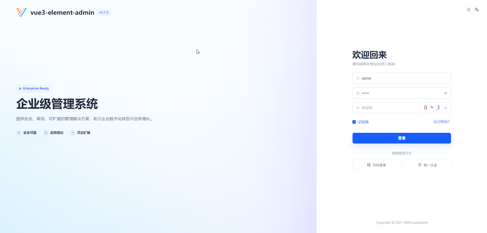
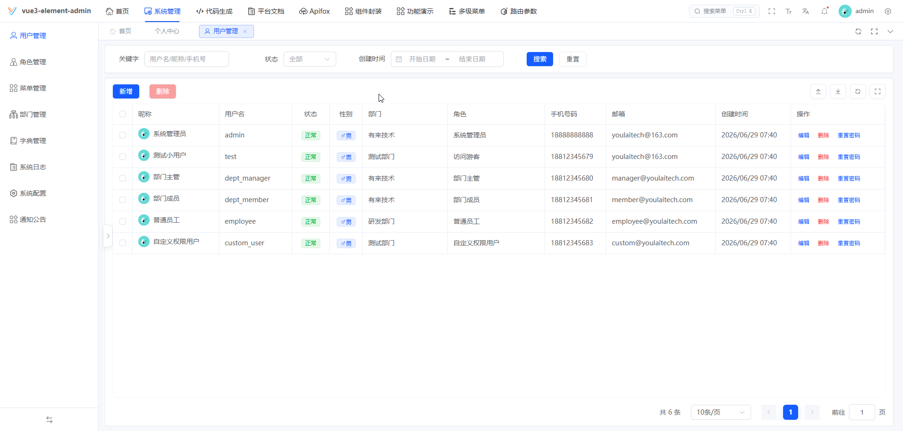
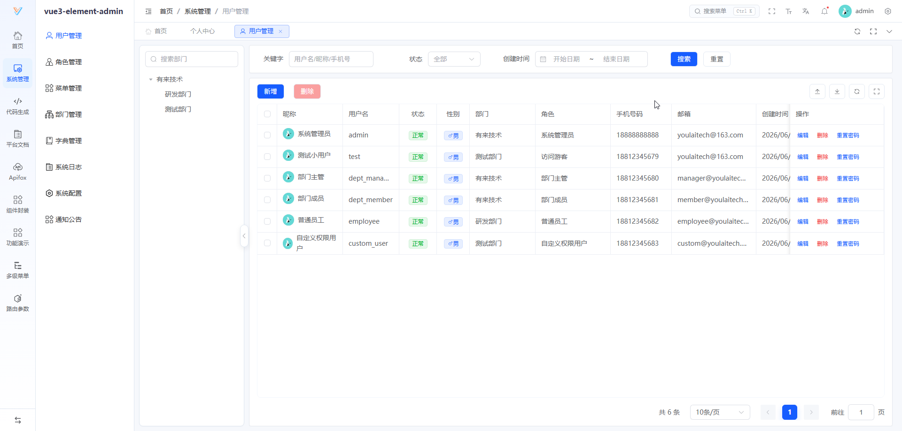
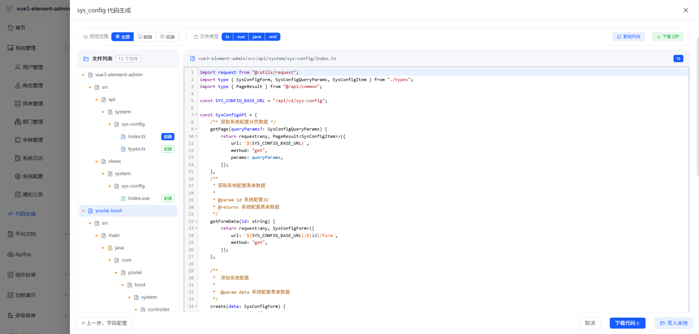
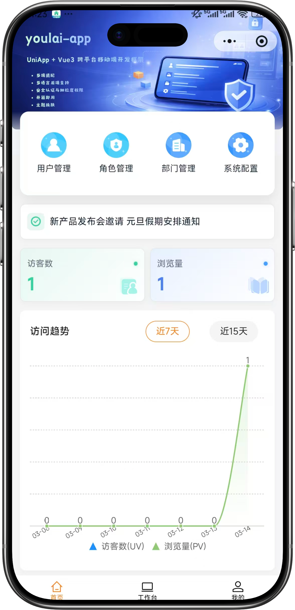
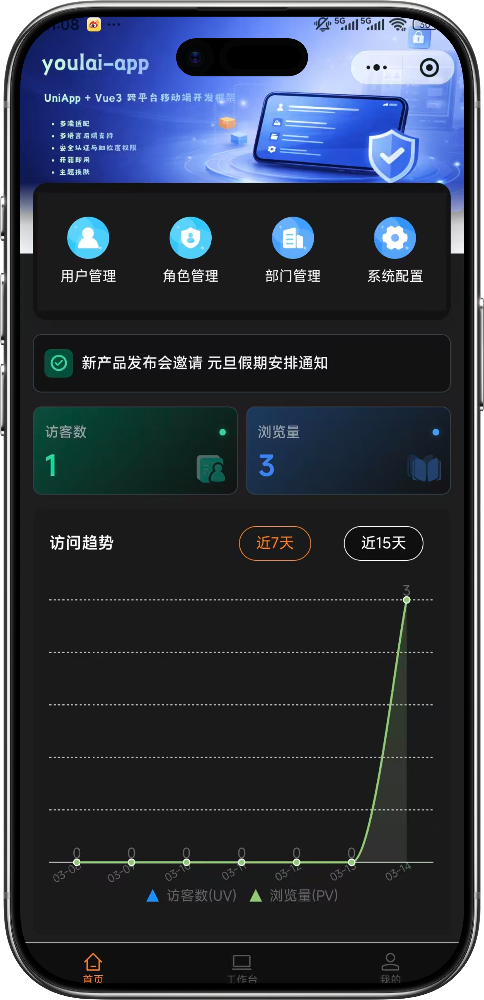
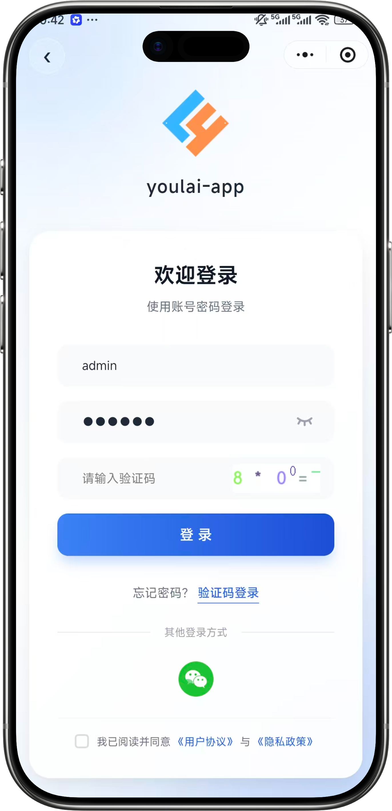

<div align="center">

#  youlai-rust

[English](./README.en.md) · [简体中文](./README.md)

**Rust 企业级权限管理系统后端（Axum + SeaORM）**

[](https://www.rust-lang.org/)
[](https://github.com/tokio-rs/axum)
[](https://www.postgresql.org/)
[](https://redis.io/)
[](LICENSE)
[](https://gitee.com/youlaiorg/youlai-rust/stargazers)
[](https://github.com/youlaitech/youlai-rust)

</div>


<div align="center">

[🖥️ 在线预览](https://vue.youlai.tech) | [📲 移动端预览](https://app.youlai.tech) | [📖 文档](https://www.youlai.tech/docs/server/spring-boot/)

</div>

## 简介

**youlai-rust** 是一套基于 Rust（Axum + SeaORM + PostgreSQL）的企业级权限管理系统后端，配套前端 [vue3-element-admin](https://gitee.com/youlaiorg/vue3-element-admin) 和移动端 [youlai-app](https://gitee.com/youlaiorg/youlai-app)，并提供 **7 种语言实现**（Java / Node.js / Go / Python / PHP / C# / Rust），共享同一套 API 规范与数据库结构。适用于追求高并发、低延迟的 Rust 技术栈团队学习与二次开发。

## 核心特性

- 🔐 **双模式认证** — JWT 自包含 / Redis Token 有状态，可切换，支持令牌续期
- 🛡️ **细粒度权限** — RBAC 数据 / 菜单 / 按钮 / 接口级，数据权限五档
- ⚡ **代码生成器** — 一键生成前后端 CRUD 代码
- 📦 **模块齐全** — 用户、角色、菜单、部门、字典、配置、文件、通知、操作日志
- 🌐 **多语言生态** — 与其它语言版本共享 API 规范与数据库结构
- 🔌 **实时通信** — SSE 推送：在线用户数、字典同步、通知广播

## 系统预览

**PC 端**

<table align="center">
  <tr>
    <td></td>
    <td></td>
  </tr>
  <tr>
    <td></td>
    <td></td>
  </tr>
  <tr>
    <td></td>
    <td></td>
  </tr>
</table>

**移动端**

<table align="center">
  <tr>
    <td></td>
    <td></td>
    <td></td>
    <td></td>
  </tr>
</table>

## 快速开始

**环境要求**：Rust 1.82+ · PostgreSQL 16+ · Redis 7.x · VS Build Tools（Windows 必装）

> **Windows 用户**：Rust 默认使用 MSVC 工具链，需要 Visual Studio Build Tools 中的 C++ 工作负载。下载 [vs_buildtools.exe](https://aka.ms/vs/17/release/vs_buildtools.exe)，安装时勾选「使用 C++ 的桌面开发」，否则会遇到 `linker link.exe not found`。

1. 克隆项目：`git clone https://github.com/youlaitech/youlai-rust.git`
2. 导入数据库：`psql -U postgres -d youlai_admin -f ../youlai-boot-postgres/sql/youlai_admin.sql`
3. 配置环境：`cp .env.example .env`
4. 启动服务：`cargo run`，访问 http://localhost:8000/swagger-ui

默认账号：`admin` / `123456`

**Docker 部署**：`cd docker`，然后 `docker-compose up -d`

## 技术栈

| 技术 | 版本 | 说明 |
|:-----|:-----|:-----|
| Axum | 0.8 | Web 框架（Tokio 官方） |
| SeaORM | 1.1 | 异步 ORM |
| PostgreSQL | 16+ | 数据库 |
| Redis | 7.x | 缓存与会话 |
| JWT / Redis Token | — | 双模式认证 |
| utoipa | 5.x | OpenAPI 文档 |
| validator | 0.20 | 请求参数校验 |
| tracing | 0.1 | 结构化日志 |
| tower-governor | 0.6 | 限流 |
| calamine / rust_xlsxwriter | — | Excel 读写 |

## 目录结构

```
youlai-rust/
├── config/                  # 配置文件
│   ├── config.toml          # 主配置（兜底默认值）
│   └── config-dev.toml      # 开发环境覆盖
├── docker/                  # Docker 部署
├── src/
│   ├── main.rs              # 程序入口
│   ├── lib.rs               # 库入口
│   ├── common/              # 公共常量 / 枚举 / 分页
│   ├── core/                # 数据库 / Redis / 配置
│   ├── entity/              # SeaORM Entity（16 张表）
│   ├── framework/           # 框架层
│   │   ├── security/        # 认证 / 授权 / 数据权限
│   │   ├── middleware/      # CORS / 日志 / 限流
│   │   ├── web/             # 统一响应 / 异常处理
│   │   ├── sse/             # SSE 实时推送
│   │   ├── captcha/         # 图形验证码
│   │   └── apidoc.rs        # OpenAPI 文档
│   └── modules/             # 业务模块
│       ├── auth/            # 登录 / 登出 / 刷新令牌
│       ├── system/          # 用户 / 角色 / 菜单 / 部门 / 字典 / 配置 / 通知 / 日志
│       ├── message/         # SSE 消息推送
│       ├── file/            # 文件管理
│       └── codegen/         # 代码生成
├── .env                     # 环境变量（本地开发）
├── .env.example             # 环境变量模板
├── Cargo.toml               # 依赖管理
└── rust-toolchain.toml      # Rust 工具链
```

## 生态矩阵

**前端**

| 项目 | 技术栈 | 说明 |
|:-----|:-------|:-----|
| [vue3-element-admin](https://gitee.com/youlaiorg/vue3-element-admin) | Vue 3 + Element Plus | PC 管理前端（主推） |
| [youlai-app](https://gitee.com/youlaiorg/youlai-app) | Vue 3 + UniApp | 移动端 App |

**后端**

| 项目 | 技术栈 | 说明 |
|:-----|:-------|:-----|
| [youlai-boot](https://gitee.com/youlaiorg/youlai-boot) | Spring Boot 4 + MyBatis-Plus | Java（主推） |
| [youlai-nest](https://gitee.com/youlaiorg/youlai-nest) | NestJS + TypeORM | Node.js |
| [youlai-gin](https://gitee.com/youlaiorg/youlai-gin) | Go + Gorm | Go |
| [youlai-django](https://gitee.com/youlaiorg/youlai-django) | Django + DRF | Python |
| [youlai-thinkphp](https://gitee.com/youlaiorg/youlai-thinkphp) | ThinkPHP 8 | PHP |
| [youlai-aspnet](https://gitee.com/youlaiorg/youlai-aspnet) | ASP.NET Core | C# |

> **youlai-boot** 还提供以下变种和分支版本：[多租户](https://gitee.com/youlaiorg/youlai-boot-tenant)（Spring Boot 4）· [MyBatis-Flex](https://gitee.com/youlaiorg/youlai-boot-flex)（Spring Boot 4）· [Spring Boot 3](https://gitee.com/youlaiorg/youlai-boot/tree/spring-boot-3) · [PostgreSQL](https://gitee.com/youlaiorg/youlai-boot/tree/db-pg) · [多模块](https://gitee.com/youlaiorg/youlai-boot/tree/multi-module)
>
> 七种后端共享同一套 **RESTful API 规范** 和 **数据库结构**，前端可无缝切换。

## 文档资源

| 资源 | 地址 |
|:-----|:-----|
| 📖 完整文档站 | [www.youlai.tech](https://www.youlai.tech/) |
| 🖥️ PC 端在线预览 | [vue.youlai.tech](https://vue.youlai.tech) |
| 📱 移动端在线预览 | [app.youlai.tech](https://app.youlai.tech) |
| 🔗 Apifox 接口文档 | [apifox.com](https://www.apifox.cn/apidoc/shared-195e783f-4d85-4235-a038-eec696de4ea5) |
| 🔗 本地接口文档 | [localhost:8000/swagger-ui](http://localhost:8000/swagger-ui) |

## 参与贡献

欢迎提交 Issue 和 Pull Request！详见 [贡献指南](https://www.youlai.tech/faq/help)。

## 开源协议

本项目基于 [Apache License 2.0](LICENSE) 开源，可免费用于商业项目。

---

<table align="center">
  <tr>
    <td align="center">
      <br>
      <sub>公众号「有来技术」</sub>
    </td>
    <td>&nbsp;&nbsp;&nbsp;&nbsp;</td>
    <td align="center">
      <br>
      <sub>小程序「有来技术」</sub>
    </td>
    <td>&nbsp;&nbsp;&nbsp;&nbsp;</td>
    <td align="center">
      <br>
      <sub>添加作者微信</sub>
    </td>
  </tr>
</table>

<p align="center"><em>技术交流 · 问题反馈 · 商务合作</em></p>
